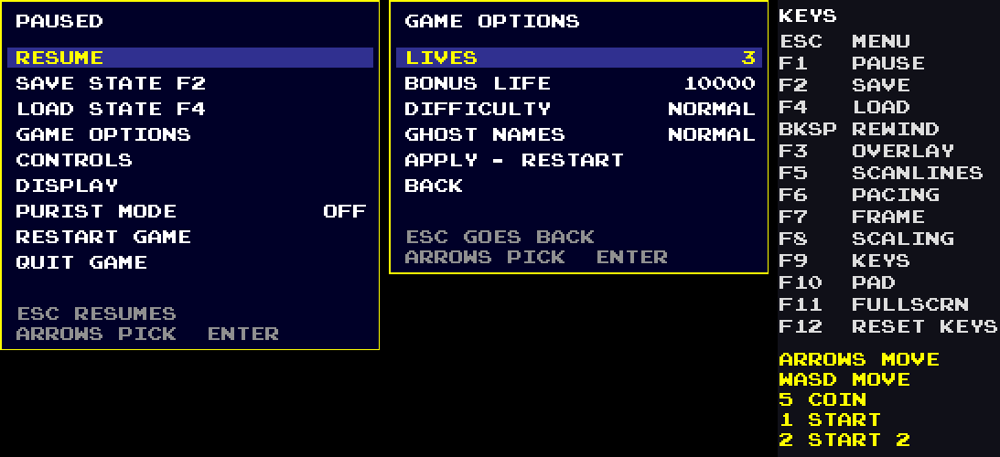
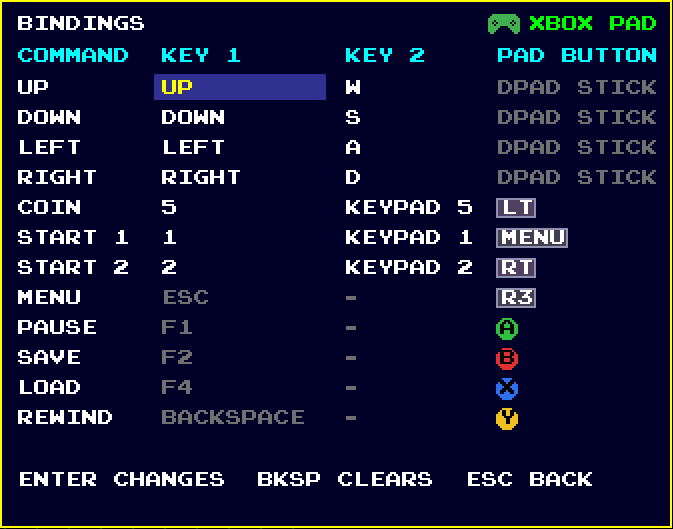
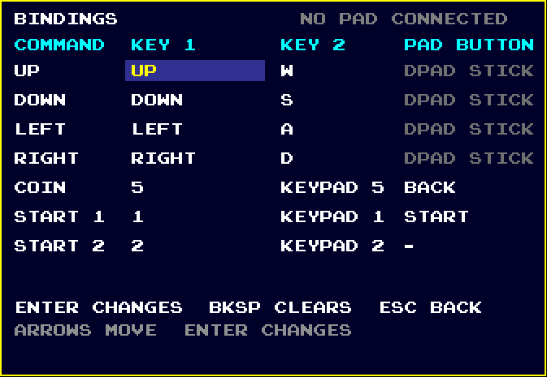
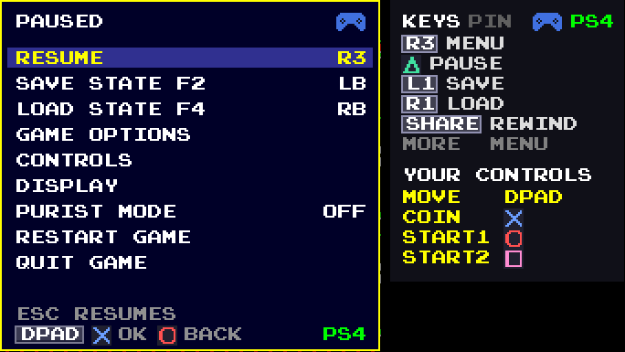

# Maze Chase (working title)

**An arcade-accurate Windows player for a classic 1980 maze game, with modern extras you can switch off.**

Maze Chase contains a software copy of the arcade machine's computer (a Z80 processor, the memory map, the video and sound chips). It runs the game's **original program** instead of a re-creation, so the game behaves like the arcade board: same ghost behaviour, same speeds, same bugs (including the famous level 256). Around that machine sits a modern front end: menus, save states, rewind, game-pad support, screen effects and more.

> **This repository does not contain the game.** No ROM, no artwork, no sound and nothing made from them is included. You supply your own copy of the ROM set (a file named `pacman.zip`). The name "Maze Chase" is a working title. The project is not affiliated with, authorised by or endorsed by the owners of the original game or its trademarks.

---

## Contents
1. [Download and run (Windows)](#download-and-run-windows)
2. [Features](#features)
3. [Controls](#controls)
4. [Purist mode](#purist-mode)
5. [Troubleshooting and FAQ](#troubleshooting-and-faq)
6. [For people who want to look inside or change the game](#for-people-who-want-to-look-inside-or-change-the-game)
7. [How the project was made](#how-the-project-was-made)
8. [Legal](#legal)

---

## Download and run (Windows)

You need: a Windows 10 or 11 PC (64-bit) and your own `pacman.zip` ROM set (the file you may legally use; the program checks that it is the right one and never changes, copies or uploads it).

1. Open the **[Releases](../../releases)** page of this repository and download `MazeChase-1.0.1-win64.zip` (under "Assets").
2. Right-click the downloaded zip, choose **Extract All...** and extract it somewhere (your Desktop is fine). Do **not** run the program from inside the zip.
3. Copy your `pacman.zip` into the extracted `MazeChase` folder, **next to `MazeChase.exe`**.
4. Double-click `MazeChase.exe`.
   - Windows may show a blue **"Windows protected your PC"** window, because the program is new and not signed with a paid certificate. Click **More info**, then **Run anyway**.
   - If the program cannot find the ROM it says so and offers **Choose file**: pick your `pacman.zip` once; the choice is remembered.
5. Press **5** to insert a coin, **1** to start. Press **Esc** for the menu.

The release folder also contains `REPORT-A-PROBLEM.bat`: start the game with it instead of the exe if something goes wrong; it writes a `problem_report.txt` you can attach to an issue.

## Features

**Accuracy**
- Runs the original Z80 program: every rule, speed table and quirk comes from the real code, not from a guess.
- Frame-exact timing (60.6 Hz like the arcade board), the original sound chip (three-voice wave generator) and the original video layout.
- Checked by an automated test suite against reference values and a second, independent prototype; many tests replay recorded play and compare the whole machine state frame by frame (`tests/`).
- High levels, including level 256, are tested against the arcade program ([docs/evidence/S30A_level256_full.txt](docs/evidence/S30A_level256_full.txt)).

**Play (Esc menu)**
- Resume, **Save state** (F2) and **Load state** (F4), eight save slots with a picker, **Rewind** (Backspace).
- **Game options**: lives (1, 2, 3 or 5), bonus life (10000, 15000, 20000 or none), difficulty (normal/hard) and ghost names (normal/alternate): the arcade's own DIP-switch settings.
- Restart game, quit game, saved high score.

**Display (Esc > DISPLAY)**
- Window or full screen (F11), integer or fill scaling (F8), optional window frame (F7), ultrawide screens.
- Screen effects: scanlines (F5), CRT shadow mask, glow, curved screen with vignette, and four ready-made CRT presets.
- Surround: plain black, an original arcade-cabinet look, or an "ambient" glow; or your own picture (`surround.png` next to the exe).
- Smooth pacing at 180 Hz (F6), debug overlay (F3), help panel with every key, run summary after a game.

**Controls (Esc > CONTROLS)**
- Remap every key; use Xbox, PlayStation 4 and PlayStation 5 pads with matching button pictures; vibration; lightbar colours on PlayStation pads (yellow while playing, red near a ghost, blue when ghosts are blue).
- Pad buttons for menu, pause, save, load and rewind; the program shows keyboard or pad hints depending on what you used last.
- Mouse works in all menus. Pause when the window loses focus.

**Statistics and records**
- Per-run statistics, personal bests for each level, achievements (taken from the public RetroAchievements list for this game, none invented by us), recorder for replays used by the tests.

(The screenshots show only this program's own menus; the game's own artwork is not part of this repository.)

## Controls

| Key | Action | Key | Action |
|---|---|---|---|
| **5** | Insert coin | **Esc** | Menu |
| **1** / **2** | Start 1 / 2 players | **F1** | Pause |
| Arrows or **W A S D** | Move | **F2** / **F4** | Save / load state |
| **Backspace** | Rewind | **F3** | Overlay |
| **F5** | Scanlines | **F6** | Smooth pacing |
| **F7** | Window frame | **F8** | Scaling |
| **F9** / **F10** | Keys page / pad page | **F11** | Full screen |
| **F12** | Reset controls to standard | | |

Everything can be changed in Esc > CONTROLS. The complete list of settings and where to find them is in [docs/notes/settings_table.md](docs/notes/settings_table.md).

Settings, controls, records and your high score are stored in `%APPDATA%\PacmanPort` (Windows key + R, type `%APPDATA%\PacmanPort`, Enter). Delete that folder to start fresh.

## Purist mode

Esc > **PURIST MODE** switches every extra off (overlay, scanlines, fill scaling, smooth pacing, one-button start, save states, rewind and the saved high score), leaving only the arcade board. The test suite proves that in Purist mode the machine state is identical to the plain emulator, frame for frame ([docs/evidence/S34_purist.txt](docs/evidence/S34_purist.txt)).

## Troubleshooting and FAQ

**"Windows protected your PC".** Click More info > Run anyway. The program is not code-signed (a certificate costs money). You can instead build it yourself ([BUILDING.md](BUILDING.md)).

**The program says it cannot find the ROM.** Put `pacman.zip` next to `MazeChase.exe` or use "Choose file". The zip must be the Midway "pacman" set (the same 10 files MAME uses); the message names what is wrong if it is a different set.

**Where do I get the ROM?** This project cannot provide it or point you to it. You must own the game and have the right to use the file.

**There is no sound.** Check the Windows output device and volume, then restart the game.

**The picture is blurry / has black bars.** Esc > DISPLAY > SCALING (F8) switches between sharp integer scaling and fill. Black bars are normal at non-matching window shapes.

**My pad is not recognised.** Plug it in before starting, then press a button once; the program shows "NO PAD CONNECTED" otherwise. Xbox, PlayStation 4 and PlayStation 5 pads are supported and tested; other pads may work but are untested.

**Does it work on Linux or Mac?** The source builds and is tested on Linux ([BUILDING.md](BUILDING.md)). The release download is Windows only.

**The game crashed or looks wrong.** Start with `REPORT-A-PROBLEM.bat`, reproduce it, close the game with Esc > QUIT GAME, and open an [issue](../../issues) with the `problem_report.txt` and the questions in [docs/BUG_REPORT_TEMPLATE.md](docs/BUG_REPORT_TEMPLATE.md).

**Is it really exactly the arcade game?** The game logic is the arcade program itself running on a software model of the machine, and every part of the model was tested against references ([docs/evidence/](docs/evidence/)). The honest limits are listed in [PROJECT_STATUS.md](PROJECT_STATUS.md) ("Known limitations").

## For people who want to look inside or change the game

- **[BUILDING.md](BUILDING.md)**: build the program yourself (Windows and Linux) and run the tests.
- **[MODDING.md](MODDING.md)**: what you can change today and how (menus, screen effects, controls, achievements, settings), and the honest state of the readable game rules.
- **[ARCHITECTURE.md](ARCHITECTURE.md)**: a map of every folder and file and how the emulator, video, audio and app fit together.
- **[CONTRIBUTING.md](CONTRIBUTING.md)**: how to report a problem or send a change.
- **[CHANGELOG.md](CHANGELOG.md)**: what changed in each version.
- [MACHINE_NOTES.md](MACHINE_NOTES.md): everything we learned about how the arcade machine works (memory map, video, sound, timing, inputs, routines).
- [src/logic/README.md](src/logic/README.md): the game's rules rewritten as readable C++, each piece proved identical to the original routine.

## How the project was made

The project was built step by step by a non-programmer working with an AI assistant (Claude), under a strict rule: **no step is accepted without evidence**. Each step has a step file ([docs/steps/](docs/steps/)), a test, and an evidence note ([docs/evidence/](docs/evidence/)); [PROJECT_STATUS.md](PROJECT_STATUS.md) lists all 100+ steps and their status, and [docs/PLAN.md](docs/PLAN.md) is the plan. In short:

1. **Study** (S01 to S13): identify the ROM, study how the machine works from public sources, disassemble and label the game program, map its memory, and cross-check the numbers against the published *Pac-Man Dossier* (everything matched). Written up in [MACHINE_NOTES.md](MACHINE_NOTES.md).
2. **Emulator** (S14 to S24): bring in a Z80 core, then build the board, video and input, proving each against a Python reference prototype until the first playable build.
3. **Sound, replay and behaviour tests** (S25 to S30A): sound chip, recorded replays that prove the machine is deterministic, timing/speed/ghost/scoring behaviour tests, level 256.
4. **Front end** (S31 to S34, X-steps): display options, controls and pads, save states, rewind, Purist mode, mouse, lightbar, statistics, achievements, CRT effects, cabinet look, ultrawide.
5. **Release** (S35 to S37): package the Windows exe, release testing, this repository.
6. **Readable rewrite, optional** (T01a to T01f): the game's rules as readable C++, proved identical to the ROM routines (not yet used by the game).

## Legal

- No game ROM, artwork, sound or code of the original game is in this repository or in the release download. The player supplies their own ROM file; the program only reads it.
- Not affiliated with, authorised by or endorsed by the owners of the original game or its trademarks. "Maze Chase" is a working title and not an official name.
- The code and documents written for this project are under the [MIT licence](LICENSE). Third-party components (SDL2, miniz, the z80 emulator core) have their own licences: [THIRD-PARTY-LICENSES.txt](THIRD-PARTY-LICENSES.txt).
